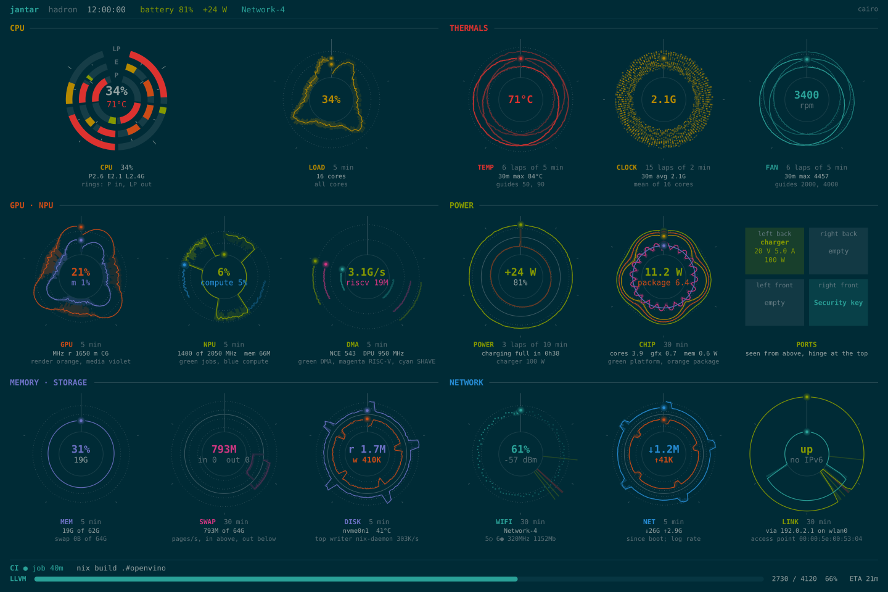
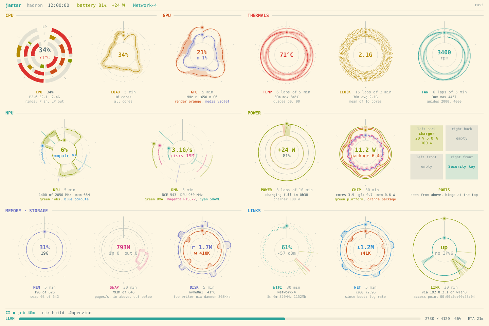
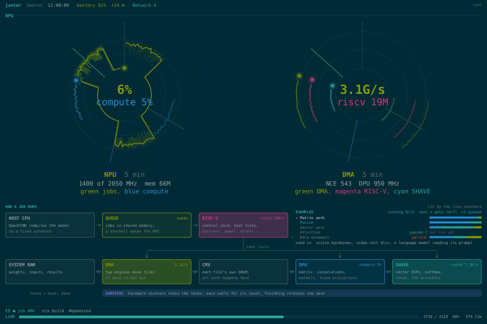

# jantar

Your whole machine on one screen, on a spare text console. Press
Ctrl+Alt+F12 and see what the CPU, GPU, NPU, memory, disks, power,
temperatures and network are doing, and what they've been doing over the
last few minutes, the last day or the last month. No desktop or login needed,
and it costs almost nothing while you're not looking.



## What it shows

| section | what you see |
| --- | --- |
| **CPU** | load per core and by core type, clock speeds |
| **GPU** | render and media engines: how busy, how fast |
| **NPU** | the AI accelerator: when it wakes, how hard it computes, the data it moves |
| **thermals** | package temperature, clocks, fan |
| **power** | battery or charger draw, where the power goes (cores, graphics, memory), which USB-C port has what plugged in |
| **memory · storage** | memory and swap use, swapping, disk reads and writes and who's writing |
| **links** | Wi-Fi signal and band, traffic, the route out, roams and drops |

A footer follows a CI build's progress when a self-hosted runner is busy.
Sensors a machine doesn't have show as `off`; everything else adapts to
what's there.

## Reading the dials

Each dial is a clock face for one measurement. Time runs clockwise from the
top, one lap per period, and the further from the centre, the higher the
value. The newest reading is the bright dot at the top; older laps fade, so
you can see at a glance whether something is steady, rising or bursting.
Radial lines mark events: Wi-Fi roams, link drops, restarts and NPU example
runs. The legend under each dial names its traces in their own colours.

## Keys

| key | overview | zoomed in |
| --- | --- | --- |
| `c` `g` `t` `n` `p` `m` `l` | zoom in on a section, in screen order (`n` the NPU, `l` links) | switch section |
| `1` `2` `3` | live, last day, last 30 days | last 1, 5, 30 minutes |
| `j` `k` `r` `x` | | on the NPU screen: pick an example, run it (or queue it behind the one running), stop it and clear the queue |
| `Esc` | | back to the overview |

It follows the desktop's light or dark theme (Solarized).



## Learning how the NPU works



Zoomed in, the NPU screen shows how a job runs on it, from the program on
the CPU through the NPU's control core to its matrix engine (DPU), vector
cores (SHAVE) and data movers (DMA), each lit by what the hardware is doing
right now.

Beside it is a library of experiments ([examples/npu](examples/npu)) in two
shelves. The lab asks one question each: How fast is the matrix engine,
and does size help? Which activations come free with a convolution? Where
does a transformer's attention run? When does moving data, not maths, set
the pace? How much faster is INT8? The applications run real workloads at
their real sizes: video-call background blur, speech to text, a language
model reading a prompt and writing an answer, object detection, and
embeddings for search. Each has a prediction written down first, what was
measured (including where the prediction was wrong) and where it shows up
in everyday use, which the screen shows for the example you pick. Pick one with
`j`/`k` and run it with `r`: the run is marked on the dials as it happens,
and its split across the engines is shown when it finishes. From a shell:
`nix run .#npu-example -- 02-fusion`.

## Running it on NixOS

The flake has a package and a NixOS module. jantar takes one virtual
console (12 by default), draws only while that console is on screen, and
keeps measuring the rest of the time, so the history is there when you
switch to it.

```nix
# flake.nix
inputs.jantar.url = "github:aaronjohnson/jantar";

# your nixosSystem's modules
jantar.nixosModules.default
{
  services.jantar = {
    enable = true;
    tty = 12;                         # Ctrl+Alt+F12; Ctrl+Alt+F1 to go back
    theme = "dark";                   # or "light", or follow a file with themeFile
    extraGroups = [ "github-runner" ]; # optional: show a CI runner's progress
  };
}
```

It runs as its own user with access to just the screen, its console and the
NPU: no network, no special privileges. Other options include `powercap`
(the power breakdown), `usbBays` (naming the USB-C ports), `npuExamples`
and `maxFps`; see [nix/module.nix](nix/module.nix).

On battery it draws at most 2 frames a second, and nothing at all while its
console isn't on screen. It needs a framebuffer console (`/dev/fb0`), which
most Linux machines have. It was built on a Framework Laptop 13 Pro (Intel
Core Ultra, Panther Lake).

## Trying it without installing

```sh
git clone https://github.com/aaronjohnson/jantar && cd jantar
nix develop
mix jantar.dump --watch            # every sensor, as text
mix jantar.png --out frame.png     # one frame of this machine, as a picture
mix jantar.png --demo              # the demo snapshot used for the screenshots
mix jantar.fb --tty /dev/tty3      # live, on a console you're logged in to
```

`mix jantar.fb` needs the `video` group and a console of your own. Ctrl+C
gives it back.

## Status

* Done: every section above, the day and month history, zooming in, the
  NPU's job diagram and example library, and the NixOS service.
* Next: a fleet view, watching several machines at once
  ([plan](docs/milestone-5-fleet.md)).

How it's built is in [docs/design.md](docs/design.md).

## Colophon

jantar is named after the [Jantar Mantar](https://en.wikipedia.org/wiki/Jantar_Mantar,_Jaipur)
observatories (Sanskrit *yantra*, "instrument"): stone sundials and
instruments for following the sun and moon, which its dials imitate. The
default branch is `dhruva`, Sanskrit for the pole star: the fixed point a
dial turns around.

The dials are drawn in [Solarized](https://ethanschoonover.com/solarized/)
and set in DejaVu Sans Mono.

## Licence

MIT. See [LICENSE](LICENSE).
