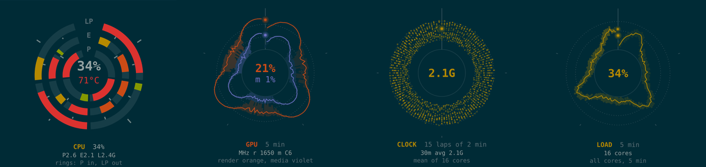
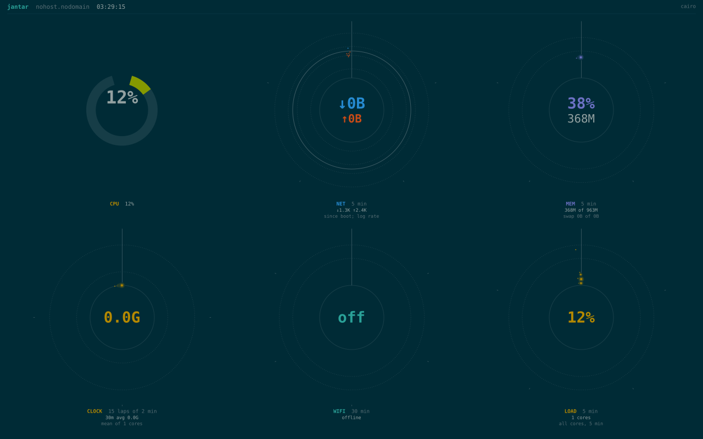

# jantar

A polar-dial system dashboard for the Linux text console, written for the
BEAM. Switch to its console (Ctrl+Alt+F12) and the whole machine is on one
screen: per-core CPU, temperature, power, network, memory, NPU, GPU, clocks,
fans, Wi-Fi, load and the CI runner. Each dial shows how its sensor has moved
over the last few minutes, not just its current value.


Named after the [Jantar Mantar](https://en.wikipedia.org/wiki/Jantar_Mantar,_Jaipur)
observatories (Sanskrit *yantra*, "instrument"): stone sundials and polar
instruments for following the sun and moon.

## Reading the dials

Time runs clockwise from the top, one lap per period (e.g. 6 laps of 5 min),
and the distance from the centre is the value. The newest sample is the
bright dot at the top; older laps fade. A busy series (sampled every 250 ms)
is drawn as a trace with a band from its minimum to its maximum; a slow one
(Wi-Fi every 20 s) keeps its dots. The CPU dial is rings of cores by tier
(performance, efficient, low-power), and the footer follows a CI build with
its progress and ETA.



It follows Solarized light or dark:


and fits whatever sensors a machine has. In a VM with six of them:



## Running it on NixOS

The flake has a package and a NixOS module. The service owns one virtual
console (12 by default), draws only while that console is on screen, and
keeps sampling the rest of the time, so the history is there when you switch
to it. No login needed.

```nix
# flake.nix
inputs.jantar.url = "github:aaronjohnson/jantar";

# your nixosSystem's modules
jantar.nixosModules.default
{
  services.jantar = {
    enable = true;
    tty = 12;                         # Ctrl+Alt+F12; Ctrl+Alt+F1 to go back
    backend = "cairo";                # or "rust"
    theme = "dark";                   # or "light", or themeFile = "/run/...";
    extraGroups = [ "github-runner" ]; # optional: read a CI runner's status
  };
}
```

It runs as its own user with access to just the framebuffer and its console,
no network and no capabilities. Other options: `framebuffer`, `maxFps` (4)
and `batteryMaxFps` (2).

It needs a framebuffer console (`/dev/fb0`, from simpledrm or your GPU
driver's fbdev emulation) and expects 32-bit XRGB pixels. It was built on a
Framework Laptop 13 Pro (Intel Core Ultra, Panther Lake); sensors it can't find
show as `off`.

## Trying it without installing

```sh
git clone https://github.com/aaronjohnson/jantar && cd jantar
nix develop                        # Erlang/OTP 28, Elixir, Gleam, Rust, cairo
mix jantar.dump --watch            # every sensor and series, as text
mix jantar.png --out frame.png     # one frame of this machine, as a PNG
mix jantar.png --demo              # the demo snapshot used for the screenshots
mix jantar.fb --tty /dev/tty3      # live, on a console you're logged in to
```

`mix jantar.fb` needs the `video` group and a console of your own. Ctrl+C
gives it back.

## How it works

```
sensors ──► History (ETS) ──► Frame ──display list──► Rust NIF  (tiny-skia) ──► /dev/fb0
one process   time-windowed     layout and dial        or
per source    samples           maths, in Gleam        C Port    (cairo)
```

* **Gleam** holds the pure, typed logic: parsing `/proc` and `/sys`, rates,
  the time-windowed history, dial geometry and adaptive sampling.
* **Elixir** holds the processes: one supervised process per sensor, so a
  missing or failing source shows as `off` without disturbing the others,
  and the display, which follows the console in front.
* **Rust or C** draws. Both receive the same display list and draw the same
  picture: the Rust NIF in the VM, about 12 ms a frame at 2880x1920, or the
  cairo program in its own process, about 6 ms, where a crash just restarts
  the renderer.

When it's on battery it draws at most 2 frames a second, and while its
console isn't on screen it draws nothing.

More in [docs/design.md](docs/design.md): processes, history, sampling,
renderers, console switching, packaging and the tests against the Python
original.

## Status

* Done: sensors and history; both renderers; the Nix package, NixOS service
  and VM test.
* Next: a fleet view, watching several machines over MQTT
  ([plan](docs/milestone-5-fleet.md)).

jantar began as a rewrite of `hud`, a Python dashboard in
[dotfiles](https://github.com/aaronjohnson/dotfiles), and is checked against
it: `tools/hud_oracle.py` runs hud's own sampler over recorded `/proc` and
`/sys` captures, and the tests compare.

## Licence

MIT. See [LICENSE](LICENSE).
