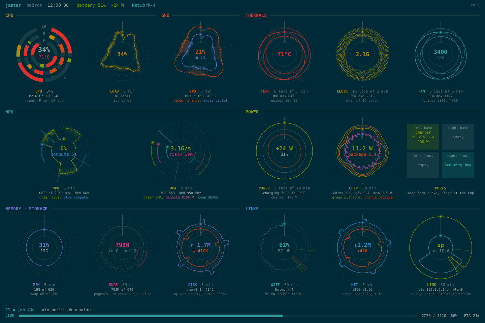
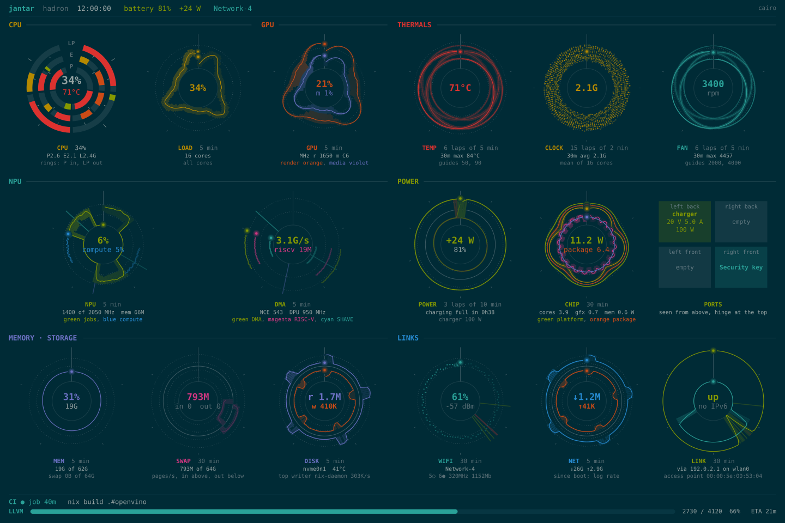

# jantar: design notes

How jantar is built, for reading or changing the code. The [README](../README.md)
has the overview.

## Layout

```
jantar/
├── flake.nix                  package, NixOS module, VM test, devShell
├── nix/                       package.nix (mixRelease), jantar-core / jantar-render /
│                              cairo-port derivations, module.nix, vm-test.nix
├── rel/                       release VM flags (no busy-waiting) and env
├── mix.exs                    Elixir app + Mix compilers for the Gleam core and the C port
├── config/                    config.exs (root, max_points, adaptive, ...), test.exs
├── gleam/jantar_core/            Gleam: pure logic, no I/O
│   ├── src/jantar_core/
│   │   ├── parse.gleam        /proc/stat, meminfo, net/dev, uptime, pid stat, cgroups,
│   │   │                      CI progress, nmcli and iw output -> typed records
│   │   ├── ring.gleam         time-windowed history bookkeeping (which samples to drop)
│   │   ├── rate.gleam         CPU load, counter rates, NPU/GPU busy, battery W and
│   │   │                      minutes, charger W, build ETA
│   │   ├── polar.gleam        dial maths: age -> angle with laps, value -> radius
│   │   │                      (linear/log, clamped, mirrored with a zero ring), fading
│   │   └── adapt.gleam        adaptive sampling: next interval from recent values
│   └── test/jantar_core/         gleeunit tests (recorded samples + hud's own results)
├── lib/
│   ├── jantar/
│   │   ├── application.ex     supervision tree
│   │   ├── frame.ex           a History snapshot -> hud's dashboard as a display list
│   │   ├── frame/demo.ex      deterministic demo snapshot (golden tests, comparisons)
│   │   ├── theme.ex           Solarized dark/light, following gsettings
│   │   ├── display.ex         dashboard supervisor; display/ticker.ex: VT watch + frames
│   │   ├── render/            display_list.ex (format), render.ex (backend API),
│   │   │                      rust.ex + native.ex (NIF), cairo.ex (Port)
│   │   ├── history.ex         owns every series, in ETS
│   │   ├── sensor.ex          behaviour + the GenServer that runs any source
│   │   ├── sensor_supervisor.ex
│   │   ├── sensors/*.ex       cpu memory net thermal fan battery charger npu gpu wifi ci_runner
│   │   ├── mode.ex            global visible / on-battery flags (:persistent_term)
│   │   ├── core.ex            the Gleam boundary (Gleam records -> Elixir maps)
│   │   ├── sysfs.ex           file reads under a configurable root; realpath
│   │   └── format.ex          hud's number formatting
│   └── mix/tasks/             jantar.dump, jantar.png, jantar.fb
├── native/jantar_render/         Rust NIF: tiny-skia + fontdue (Rustler)
├── c/cairo_port/              C Port: cairo + FreeType
├── docs/                      design notes, screenshots, milestone 5 plan
├── test/                      ExUnit tests; fixtures/capture = recorded /proc and /sys
└── tools/
    ├── capture-fixtures.sh    snapshot this machine's sources into test/fixtures/capture
    └── hud_oracle.py          run hud's own Sampler over the fixtures -> hud_expected.json
```

## How Gleam is built into Mix

The Gleam core is an ordinary Gleam project (`gleam/jantar_core`, with its own
`gleam.toml`, `manifest.toml` and `gleam test`). `mix.exs` defines a tiny Mix
compiler, `Mix.Tasks.Compile.JantarCore`, that runs first (`compilers:
[:jantar_core | Mix.compilers()]`). It runs `gleam build --target erlang` and
prepends each `build/dev/erlang/*/ebin` to the code path. Elixir then calls
Gleam modules as Erlang modules: `:jantar_core@parse.cpu_times(text)`. If
`JANTAR_CORE_BUILD` is set, the compiler skips the Gleam toolchain and just adds
`$JANTAR_CORE_BUILD/*/ebin`. That's the hook for Nix.

**Why not `mix_gleam`?** I tried it: v0.6.2 does still work with Gleam 1.19
when the Gleam sources sit in the Mix project's own `src/`. But it needs a Mix
archive installed into `MIX_HOME`, and Gleam's Hex dependencies become Mix
dependencies. With the Gleam project as a path dependency, the versions in
`gleam.toml` have to be repeated in `mix.exs` and kept in step (my first try
failed on exactly that `gleam_stdlib` mismatch). The plain approach has fewer
moving parts:

* the Mix project's only dependency is Rustler (for the NIF, milestone 3);
  the Gleam core needs none on the Mix side;
* the Gleam project's dependencies (gleam_stdlib, gleeunit) are locked with
  checksums in `manifest.toml`;
* for Nix that means two simple derivations: one runs `gleam export
  erlang-shipment` with the Hex tarballs fetched from `manifest.toml`'s
  checksums, and one builds the Mix release with `JANTAR_CORE_BUILD` pointing at
  the first (see "Packaging" below for the renderers). (Releases will also need the Gleam
  ebins copied into the release; that comes with packaging.)

`Jantar.Core` documents how Gleam values look from Elixir (`Ok(x)` is
`{:ok, x}`, `None` is `:none`, a record `MemInfo(..)` is `{:mem_info, ...}`)
and converts the records the app keeps into maps.

## Design

### Processes

```
Jantar.Supervisor (rest_for_one)
├── Jantar.History            owns the ETS tables
└── Jantar.SensorSupervisor   (one_for_one)
    ├── Sensor(Cpu)  ├── Sensor(Memory)  ├── ... one per source
```

`Jantar.Sensor` is a behaviour plus the one GenServer that runs every
source, the way `GenServer` runs your callbacks. A source module only
implements `defaults/0`, `init/1` (find the source; declare series and
windows) and `sample/2` (one reading). Scheduling, pushing to History, backoff
and error handling live in one place, and sources are tested by calling
`init/1` and `sample/2` directly.

A **missing source never crashes**: `init/1` returns `{:unavailable, reason}`,
and the sensor records that, then tries again after 5 s, 10 s, ... up to 5 min.
An exception in a source is treated the same way. So there are no supervisor
restart loops, and a machine without an NPU or a CI runner just shows those as
`off`.

The top level is **`rest_for_one`**, not `one_for_one` as first sketched. If
History restarts, its ETS tables are gone, so the sensors are restarted after
it and declare their series again. A crashing sensor still restarts alone,
and its history survives in History's tables.

### History: one ETS row per sample

* `:jantar_samples` (`ordered_set`): `{{series, seq}, t_ms, value}`. Each
  sample carries its own **monotonic timestamp**. The table is ordered, so one
  series' samples sit together in time order, and `History.samples/1` walks just
  that range. A push inserts one small row. Keeping a whole ring in one ETS
  value would copy up to 7200 points on every 250 ms push.
* `:jantar_state` (`set`): each series' window bookkeeping (a Gleam
  `ring.Ring`), and each sensor's status and latest values.

Both tables are `:protected`: only History writes, and anyone reads without
sending a message. **Rings are sized by time**: each series keeps a window
(hud's: 5 min for load/mem/net/NPU/GPU, 30 min for temp/clock/power/fan/wifi),
so faster sampling holds more points. Each series is capped at
`config :jantar, max_points: 7200` (30 min at 250 ms). Which samples to
drop is decided in Gleam (`ring.trim`, which asks for timestamps through a
callback); History applies it.

### Sampling intervals

Defaults, measured on this machine. Each one can be changed with
`config :jantar, Jantar.Sensors.X, interval: ...`.

| sensor     | interval | notes |
|------------|----------|-------|
| cpu        | 250 ms   | per-core clocks read at most every 1 s (`clock_every`) |
| net        | 250 ms   | |
| gpu        | 250 ms   | per GT (render, media) |
| npu        | 250 ms awake / 2 s suspended | from `power/runtime_status`; reading doesn't wake it |
| thermal    | 500 ms   | coretemp package |
| memory     | 1 s      | |
| fan        | 1 s      | the EC updates about once a second |
| battery    | 1 s      | current/voltage/status → W; capacity and minutes every 10 s (`detail_every`) |
| charger    | 10 s     | USB-C source offer |
| wifi       | 20 s     | nmcli + iw, killed after 10 s; blocks only its own process |
| ci_runner  | 2 s      | `systemctl is-failed` at most every 30 s while stopped |

Battery *status* is read every second along with current and voltage, not
every 10 s, because it sets the sign of the power reading.

**Adaptive sampling** (`config :jantar, adaptive: true`, or per sensor):
after each sample the Gleam `adapt.next_interval` looks at the last 8
values of the sensor's first series. It halves the interval when the latest
step is at least half the recent range, grows it by a quarter when the signal
is flat or settling, and keeps it in between. Steps under `:noise` count as
flat. The interval stays between the configured interval and `:max_interval`
(default 8x). It is off by default.

**Mode** (`Jantar.Mode`, in `:persistent_term`): `visible` and
`on_battery`. The battery sensor sets `on_battery`; the display's ticker sets
`visible` from the foreground VT. While hidden and on battery, sensors stretch
their intervals by `config :jantar, hidden_on_battery_factor:` (default 1:
the mechanism is in place, the slowdown is off until chosen).

### Dial maths (polar.gleam)

The angle comes from a sample's real age (`now - t`), not its index, so
irregular sampling (adaptive, backoff, NPU sleeping) plots in the right
place. A window longer than the dial's period wraps into laps. `fade` and
`thinned` are hud's age styling, keyed by the sample's sequence number so
thinning doesn't flicker.

## Renderers

| Rust NIF (tiny-skia) | C Port (cairo) |
|---|---|
|  |  |

### One picture, two backends

```
History ──snapshot──► Jantar.Frame ──display list (one binary)──► backend ──► PNG / framebuffer
                       (layout, colours,                            Rust NIF   (tiny-skia + fontdue)
                        dial geometry via                           C Port     (cairo + FreeType)
                        Gleam polar)
```

`Jantar.Frame` is hud's `FbRenderer` moved to the BEAM: same panels,
layout, dial periods and laps, fading dots, glow on the newest samples, CPU
core rings by tier, captions, header and CI footer with progress bar and ETA.
**All dial maths happens once, on the BEAM, in Gleam `polar`**; the backends
receive a display list of primitives (rects, lines, circles, arcs, polylines,
text runs; format in `render/display_list.ex`) and only rasterise it. So the
two pictures are the same by construction (the tests check they differ in
under 2% of pixels; text hinting accounts for most of that), and the maths
has one source of truth. The list is one binary (60 KB live, 190 KB for the
dense demo), so data crosses into native code without per-value term
decoding.

* **Rust** (`native/jantar_render`, `Jantar.Render.Rust`): a Rustler NIF.
  Drawing runs on a **dirty CPU scheduler**, so a 10-30 ms frame never blocks
  the normal schedulers. Fonts and the open framebuffer are NIF resources.
* **cairo** (`c/cairo_port`, `Jantar.Render.Cairo`): a separate OS process
  speaking `{:packet, 4}` on stdin/stdout. cairo's RGB24 is the framebuffer's
  XRGB8888, so it draws into framebuffer-layout memory with
  `cairo_image_surface_create_for_data`. By default that is an offscreen buffer
  with the framebuffer's stride, and only the 16-row bands that changed are
  written to the framebuffer. `config :jantar, cairo_direct: true` draws
  straight into a memory mapping of it instead, for comparison: each
  half-drawn frame shows (flicker), and see below. The Rust backend writes
  changed bands the same way.

**Write, don't map.** Both backends write bands with `pwrite()` on
`/dev/fb0`, as the Python hud does, not into an `mmap` of it. A write goes
through the DRM driver's fbdev emulation, which marks that part of the screen
damaged and flushes it. Stores into a mapping reach the memory without the
driver knowing, and on Intel graphics with panel self refresh (PSR) the panel
then keeps showing whatever it last fetched: the first frame, frozen. It
worked in tests on a stand-in file and in the VM (no PSR) and froze on the
laptop.

**Adaptive display**: a series with more samples per lap than there is room
for dots (`polar.dense`, about one dot per 3 units of arc) is drawn as a
min..max band per few pixels of arc with a line through the means
(`polar.buckets`). A 250 ms CPU or network series then reads as a trace, not
a blur. Sparse series (wifi every 20 s, a 1 s clock over 15 laps) keep
their dots. Lines break at gaps and at values a log scale can't show (an idle
NPU). Frames are paced by the fastest sensor behind the panels on screen
(4 fps with the 250 ms CPU dial, at most 1 s apart), capped by `:max_fps` (4)
and `:battery_max_fps` (2).

### The display

```
Jantar.Display (rest_for_one)
├── backend   (Rust or cairo)
└── Jantar.Display.Ticker
```

The ticker reads `/sys/class/tty/tty0/active` every 500 ms and draws only
while it says `tty12`. On becoming visible it sets `Jantar.Mode` visible,
switches the tty to `KD_GRAPHICS` (the console stops drawing text over us)
and redraws everything. Sensors keep collecting regardless. If the backend
dies, the ticker restarts after it and maps the framebuffer afresh.

**Switching VTs.** In the default, automatic switching mode the kernel
*ignores* every switch away from a VT in `KD_GRAPHICS` (`change_console` in
`drivers/tty/vt/vt_ioctl.c`): Ctrl+Alt+F1 would do nothing. So before using
`KD_GRAPHICS`, the ticker puts the VT in **process mode** (`VT_SETMODE`) with
SIGUSR2 as the release and acquire signal, as X servers do.
`Jantar.Display.VtSignal` routes the signal from the VM's
`:erl_signal_server` to the ticker:

* switching away: the kernel sends SIGUSR2 and waits; the ticker stops
  drawing and answers `VT_RELDISP 1`, and the switch completes;
* switching back: SIGUSR2 again; the ticker answers `VT_RELDISP VT_ACKACQ`
  and redraws everything.

The VT stays in `KD_GRAPHICS` while away, so it doesn't flash text on the
way out. On exit the ticker restores `KD_TEXT` and automatic mode. If the VM
dies instead, the kernel finds the signal's target gone on the next switch
and resets the VT to text and automatic mode itself (`reset_vc`), and the
service's `ExecStopPost` restores text mode too. If process mode can't be set,
`KD_GRAPHICS` isn't used at all: the console may draw over the dashboard, but
it never traps anyone. The NixOS VM test checks all of this, including
killing the service while it's on screen.

`KDSETMODE`, `VT_SETMODE` and `VT_RELDISP` are ioctls in the Rust NIF, made
from the BEAM's own OS process whatever the backend: the kernel allows them on
a process's controlling terminal, and under the service the tty is the BEAM's
(`StandardInput=tty`). A Port runs in a session of its own, so the cairo
program couldn't.

```sh
mix jantar.fb                                   # rust, /dev/tty12, /dev/fb0
mix jantar.fb --backend cairo --tty /dev/tty12
# Without /dev/fb0 access: a stand-in file and a fake "active VT" file
mix jantar.fb --fb /tmp/fake-fb --size 1440x960 --active-file /tmp/active   # then: echo tty12 > /tmp/active
mix jantar.png --demo --backend cairo --size 2880x1920 --repeat 20          # timing
```

Running it by hand needs `/dev/fb0` (group `video`) and a tty you own: log
in on a console and give it that one (`--tty /dev/tty3`). The NixOS service
owns its tty instead (see the README).

### Comparison

At 2880x1920 (this machine's panel), 20 renders, median:

| | draw a frame | notes |
|---|---|---|
| Python hud (Pillow, 2x supersampled) | 43 ms | `hud --fb --png --samples 900` |
| Rust NIF (tiny-skia) | 12 ms live, 25 ms dense demo | |
| cairo Port | 6 ms live, 17 ms dense demo | |

Building the display list on the BEAM takes 2-4 ms per frame in steady
state. Running the display for 20 s at 4 fps into a 2880x1920 stand-in
framebuffer with live data: Rust 29 ms per frame (draw plus conversion to
XRGB plus band compare), BEAM RSS 184 MB; cairo 9 ms per frame, BEAM RSS
123 MB plus 73 MB for `cairo_port` (full-screen buffers for the back
buffer and the previous frame; measured when it still mapped the framebuffer too). tiny-skia draws into RGBA and needs a
conversion pass to XRGB; cairo draws in the framebuffer's format directly.

### When native code fails

* **cairo Port**: `mix jantar.fb --backend cairo --crash-after 4` (or
  `Jantar.Render.Cairo.crash/1` with `allow_crash: true`) makes the C program
  dereference NULL. The port reports exit status 139 (SIGSEGV), the backend
  process exits, its supervisor starts a new one with a new OS process, and
  the ticker restarts after it and redraws. The VM, sensors and history are
  untouched (tested in `native_failure_test.exs`).
* **Rust NIF**: a Rust **panic** is caught by Rustler at the NIF boundary
  and raised as an Erlang error in the calling process (tested with
  `Native.panic_demo/0`). A real **memory fault** (a bad `unsafe` block, a
  bug in a C library underneath) is different: the NIF runs inside the BEAM's
  own OS process, so a segfault kills the whole VM, with all sensors and
  history. That is the trade: the NIF has no copying or process boundary,
  and the Port isolates failures.

### Packaging

`nix/package.nix` builds an Elixir release with `mixRelease`. The parts that
aren't Elixir are separate derivations, handed in through environment
variables, so no Gleam, cargo or make runs inside the Mix build:

* `nix/jantar-core.nix`: the Gleam core, with its Hex packages fetched by the
  checksums in `manifest.toml` (`JANTAR_CORE_BUILD`);
* `nix/jantar-render.nix`: the Rust NIF, crates vendored from `Cargo.lock`
  (`rustPlatform.importCargoLock`); Rustler skips compilation and loads it
  from `priv/native` (`JANTAR_RENDER_NIF`);
* `nix/cairo-port.nix`: the C program (`CAIRO_PORT_BIN`);
* Mix dependencies (Rustler and its `jason`) from Hex by fixed hash
  (`fetchMixDeps`); fonts from `dejavu_fonts` (`JANTAR_FONT_DIR`).

The release runs with `-noinput` and with scheduler busy-waiting off
(`+sbwt none +sbwtdcpu none +sbwtdio none`, `rel/vm.args.eex`): an idle
scheduler otherwise spins briefly before sleeping, which costs CPU and
wakeups for no gain in a dashboard that wakes a few times a second. It has
no Erlang distribution (no epmd, no cookie).

`nix/module.nix` is the NixOS service: its own system user in `video`, its
tty handed over by a udev rule and held as controlling terminal (no
capabilities), `DeviceAllow` for just the framebuffer and that tty, no IP
networking, and `ProtectSystem=strict` with the usual hardening.
`nix/vm-test.nix` boots it in a VM: drawing, switching away and back, a
segfaulting renderer, a killed service, and stopping.

## Checking against hud

`tools/capture-fixtures.sh` snapshots every file hud reads (twice, 2 s apart)
into `test/fixtures/capture/{t0,t1}`, laid out like the real root, with MACs
and SSIDs anonymised. `tools/hud_oracle.py` runs **hud's own `Sampler`**
over those trees, with its file access redirected, and writes
`hud_expected.json`. The Gleam and ExUnit tests check parsed values and
computed rates against that file: CPU load per core, tiers, clocks, memory,
net rates and totals, temperature and fan paths, battery and charger, NPU,
GPU busy per GT, and wifi links.

```sh
tools/capture-fixtures.sh            # re-record (then re-run the oracle)
nix shell nixpkgs#python3 -c python3 -I tools/hud_oracle.py ~/dotfiles/bin/hud \
    test/fixtures/capture > test/fixtures/capture/hud_expected.json
```

Known small differences from hud:

* hud measures intervals as float seconds; jantar uses integer
  milliseconds (agreement to ~1e-6 on GPU busy).
* When `iw` omits width, dBm or bitrate, hud keeps the previous value and
  jantar reports 0. hud only shows them while connected.
* `round()` is half-away-from-zero in Gleam and Elixir, and half-to-even in
  Python. This only matters for exact .5 values in formatting.
